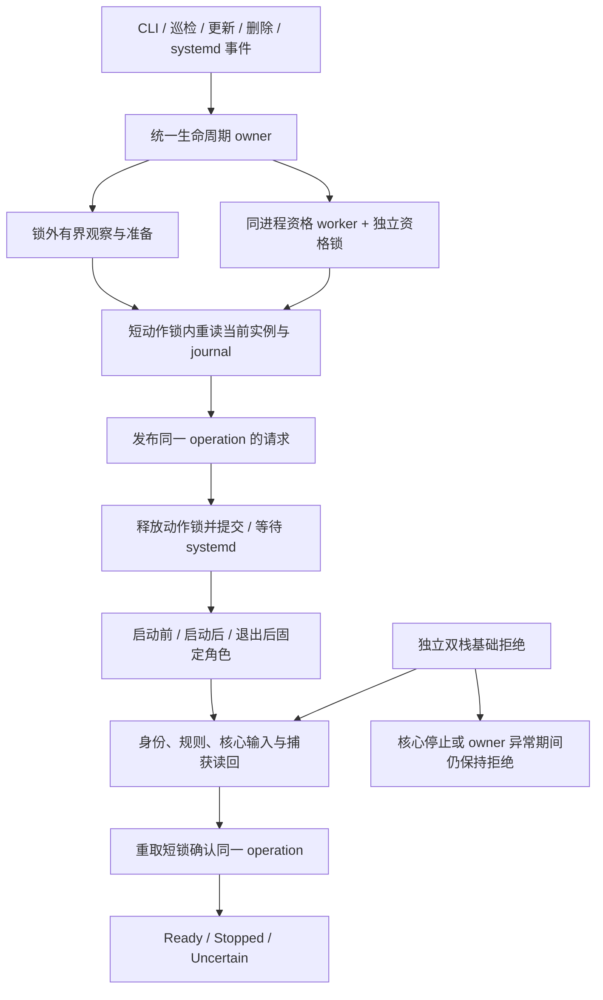

# bui-c 恢复与双栈出口保护：架构、实现边界与接手指南

> 记录日期：2026-10-10。本文是公开的设计与交接记录。**4.1.9 仍是未发布候选，完整生命周期保护尚未交付，不能据此宣称已证明无泄漏。** 本次文档整理只核对交接记录和源码，没有重新运行测试、构建、容器或实机操作。

目标有两部分：控制面只根据**当前、重新核实的本地故障**中断实例；数据面在启动、运行、退出和恢复期间保持 IPv4、IPv6、DNS 的**受管转发或明确阻断**。外部网站超时、HTTP 拒绝和连续失败次数都不能单独授权重启。

本文给后续实现者提供模块地图、已完成工作、实际入口缺口和执行顺序。历史检查结果只对其注明的源码快照与场景有效，不能用局部通过覆盖整包、真实 hook、冷启动或物理出口验证。

## 1. 公开审查基线与本地候选快照

| 对象 | 截至记录日期的状态 | 可以据此得出的结论 |
| --- | --- | --- |
| GitHub 审查入口 | PR #9 为 open draft；head 分支 `codex/bui-c-recovery-guard`，基线提交 `1e8c1431a362d800273ed073495f452bdb8827ee`；base 分支 `codex/ipv6-direct-production` | 这是本次文档整理开始时可见的审查基线；后续文档提交会改变分支 HEAD。 |
| 默认分支 | `main` 为较早的 `080f7f2` 基线 | 不能把默认分支内容当成本地最新 Rust 候选。 |
| 本地新增实现 | 近期 owner、guard、身份观察及相关接线的新增文件和修改仍未提交 | 本次公开工作记录不等于这些产品代码已上传；下文模块地图包含本地候选实现。 |
| Rust 冻结源码清单 | `451d45118619a4bc5bc460311bac2ac4a0267baee1542e150d82193bf704651d` | 这是冻结源码清单的 SHA-256，**不是 Git commit**。后续接手应逐文件核对快照，不能直接按 Git SHA 使用。 |
| 版本 | 工作区、锁文件和变更记录已分配 4.1.9；交接记录确认的既有运行基线为 4.1.8 | 版本分配只标识候选，未产生发布、部署或自动更新资格。 |
| 外部核心 | 原版 sing-box **1.14.2** | 本项目修改 Rust 控制面与配置渲染；不修改外部原版核心。 |

下文源码路径均以仓库根目录为起点，用于定位本地候选快照；不提供指向尚未提交模块的相对链接。公开读者若在当前审查基线找不到某个模块，应先确认该候选源码是否另行完成审查与提交，不应将文档里的实现描述误读为当前 GitHub 已有的代码。

## 2. 从旧控制方式到目标生命周期

当前客户端以 `profiles.json` 表达用户意图，以 `runtime.json` 保存可重建的运行信息；`Engine::apply` 渲染配置和 systemd 单元，再直接启动或重启 sing-box。巡检由 oneshot 服务和 timer 触发。恢复策略和当前实例复核已有改进，但产品动作仍存在多条旧入口。

目标架构是在保留 `Sys`、`Net`、现有 flock 与 schema 渲染边界的基础上，收敛到一个 Rust 生命周期 owner。owner 是负责动作协调和当前资格持有的进程；journal 是记录 operation、阶段和请求代次的数据。两者职责不同：磁盘记录不能恢复已经失效的进程资格，也不能证明当前内核规则仍然成立。



**这是目标调用链，不是已完成的产品启动图。** 当前 owner pump 的生产分发只接入 owner 和两种 StopPost 角色；完整发布、Start/Restart、启动前后角色、可信核心启动以及所有维护入口仍需接线。

### 三种状态必须分别报告

| 维度 | 回答的问题 | 不能替代它的信号 |
| --- | --- | --- |
| 本地数据面 | 当前实例、接口与路由是否符合当前请求？ | 单独的 `active`、TUN 名字存在或一次 IPv4 route-get。 |
| 外部可达性 | 本次受管探测得到了什么 HTTP 或失败类别？ | 失败次数、多站投票或未经验证的直连对照。 |
| 捕获与出口保护 | 当前两族业务和 DNS 是否受管转发或被阻断？ | HTTP 204、规则文本正确、历史 receipt 或写入成功。 |

`ExternalDegraded` 表示外部异常而没有足够本地中断依据；`Uncertain` 表示当前证据不足。退避只能限制已经获得本地资格的恢复动作，不能生成恢复资格。确认停机必须来自有效的 `ServiceObservation::Stopped`，查询失败不能当作停机。

## 3. 设计决策与必须维持的约束

| 决策 | 采用方式 | 原因与验收重点 |
| --- | --- | --- |
| 外部异常不授权破坏性恢复 | 超时、拒绝和持续外部失败保留诊断；当前本地故障才进入恢复判断 | 避免正常长连接因单个目标故障被中断，同时保留真正本地故障的正向恢复路径。 |
| 恢复绑定实例代次 | 组合服务 InvocationID、PID、启动信息、boot、请求配置、profiles 与网络 basis；探测前后及动作前重验 | 配置字节相同不代表实例相同；systemd 重新拉起也是新实例。旧探测不得操作新实例。 |
| 同一把短动作锁 | 观察和耗时等待放锁外；锁内重读当前数据、发布或确认同一 operation | 当前旧入口存在持锁同步 systemd 的情况；先安装也要取锁的 hooks 会造成 job 等 hook、hook 等锁。 |
| journal 只记事实与阶段 | pending、operation、attempt、epoch 等用于关联和拒绝过期动作 | 磁盘记录、JSON 报告、ACK 或成功写入均不能制造当前 Guard/Ready 资格。 |
| runtime 采用 fresh merge | 锁内严格加载最新 runtime，只修改本写者负责的字段，再原子保存 | 避免健康检查覆盖更新记账。已有 fresh merge 应继续复用；缺口主要是业务动作尚未统一。 |
| 长任务由同进程资格 worker 承担 | worker 使用独立资格锁；owner 前台只做有界轮询与短动作锁确认 | 保持 owner 响应能力，取消后仍负责收集和清理；序列化结果不能替代同进程不可伪造的证明。 |
| 全操作共用原期限和预算 | Core、配置、策略、nft、最终确认共享 `PublicationReadScope` 的截止时间、累计读取预算及代次约束 | 进入下一层读取或 warm 确认不能给旧事实续期；超时、变化和取消保持不确定或拒绝。 |
| guard 独立于核心生命周期 | 只原子修改 BUI 自有 inet 表，基础拒绝在 stop、kill、restart 和失败时保留 | 不通过删表恢复连通；不 flush 全部 ruleset，不修改其它服务的 nft 表。 |
| 例外取身份与端点交集 | 核心例外绑定真实服务 socket cgroup、所选 literal 地址、协议与有限端口范围；管理例外绑定实际身份与具体连接 | 不采用 root UID、宽泛 mark、任意 SSH/UDP 端口或通用 established/related 放行。旧旁路连接同样要被阻断。 |
| 启动输入固定且可核对 | sealed input 和可信 launcher 对请求配置、核心文件及当前角色作约束 | 请求配置 SHA 只证明磁盘请求；输入固定、文件 SHA 相等也不等于核心已按该配置运行或具备发布来源信用。 |
| 全捕获配置与 guard 一起交付 | 渲染在 `bui-schema`；两族与 DNS 沿所选代理，不保留与全捕获冲突的普通业务 direct 例外 | renderer、guard、hooks 和恢复入口构成一个交付单元，不能单独启用一部分后宣称防漏完成。 |
| 覆盖范围显式限定 | 当前平台和 guard 证据限定宿主本机 OUTPUT | AF_PACKET、容器 FORWARD、桥接不因此获得覆盖。若扩展容器范围，必须同次增加相应实现和真实门禁。 |

没有全局 IPv6 地址时仍保留 IPv6 基础拒绝；新接口和新上行不能逃出基础规则。冷启动所需的解析、网关发现、地址配置和控制下载需要单独的有限准入设计与验证，不能用宽泛 root 放行补足。

普通停止代理与显式解除保护必须是不同操作。卸载、回滚和异常清理也不能借删除 guard 打开物理出口。无数据面变化的 no-op 或仅客户端自身更新，不应触发无关的核心重启或撤销保护。

## 4. 模块职责地图

下表描述本地候选快照的职责边界；“已具备源码”不等于“已被产品入口调用”。

| 路径 | 职责 | 当前实现边界 |
| --- | --- | --- |
| `crates/bui-c/src/check.rs` | 健康决策、typed 外部探测、本地恢复依据、巡检记账 | 外部失败策略和当前实例复核已有 focused 验证；实际重启动作仍需迁入 owner。 |
| `crates/bui-c/src/service.rs` | 一次 systemd 查询解析为 Running、Stopped 或不确定状态 | 表达服务实例，不提供 loaded-config、捕获或 guard 资格。 |
| `crates/bui-c/src/net.rs`、`nettest.rs` | 受管探测、HTTP/错误类别和耗时 | 不把未知错误猜成 DNS/TLS/特定地址族；TUN 捕获不明时不能发可能旁路的诊断。 |
| `crates/bui-c/src/recovery.rs` | 当前 basis、观测新鲜性、严格 runtime 读取与锁内 fresh merge | 配置摘要代表请求配置；显示用缺省 runtime 不能授权动作。 |
| `crates/bui-c/src/lifecycle.rs` | operation journal、prepare/publish/enqueue/finalize、hook 阶段与当前代次 | 发布和完整启动链尚未接入实际产品调用；live 完整证据不足时保持 `Uncertain`。 |
| `crates/bui-c/src/action_scope.rs` | 短锁准备、锁外等待、重取锁收尾的调度 | 回调结果只是数据；不重试业务回调，不自行授予实时权限。 |
| `crates/bui-c/src/owner_pump.rs` | owner 前台循环、peer 调度、warm 确认、StopPost 处理 | 已接三个固定角色；当前只接受已有 Running main 的 warm 路径，不发布或启动新 main。 |
| `crates/bui-c/src/owner_qualification.rs` | 同进程资格任务调度、取消、完成轮询与回收 | 外部消息不能注入完成证明；已有独立 worker 实验不替代完整 realm 与产品验收。 |
| `crates/bui-c/src/owner_channel.rs` | 固定本地 Unix 通道、有界消息、内核 peer 观察 | 消息都是数据；不因收到角色名或请求字段就构造 HookOwner、Guard 或 Ready。 |
| `crates/bui-c/src/hook_owner.rs` | 当前 systemd hook/owner 身份与阶段核对 | 依赖真实服务和进程观察；环境变量或自报角色不构成资格。 |
| `crates/bui-c/src/core_exec.rs` | 原版核心 sealed 配置输入与执行边界 | `prepare_sealed_input`、`exec_original_core` 已有源码和相关测试，但当前 unit 尚未调用该启动链。 |
| `crates/bui-c/src/guard.rs` | 宿主 OUTPUT 规则计划、原子修改、规范化内核读回和收缩 | `GuardQualification` / `GuardReceipt` 不反序列化；真正资格来自当前平台和内核读回。 |
| `crates/bui-c/src/platform_qualifier.rs` | 隔离 socket-cgroup 平台资格及独占对象清理 | 序列化报告不授予核心 socket、管理 SSH、FORWARD 或冷启动资格。 |
| `crates/bui-c/src/socket_identity.rs` | pidfd、原进程 FD、inet_diag 与 cgroup 代次关联的真实 socket 观察 | 纯解析不授予许可；事实不能独立证明完整捕获。 |
| `crates/bui-c/src/tun_identity.rs` | 当前 MainPID 在当前网络命名空间内的 TUN 持有关系 | TUN 所属证明不包含路由、DNS、有效配置或 Ready。 |
| `crates/bui-c/src/management.rs` | 有限且新鲜的 SSH 管理连接身份观察 | 管理例外需要真实身份与端点；不能按端口或 root 身份泛化。 |
| `crates/bui-c/src/identity_validation.rs` | 私有只读身份诊断 | 输出是诊断数据，不建立生产授权，也不等于 Ready。 |
| `crates/bui-c/src/privileged_command.rs`、`sys.rs`、`lock.rs` | 有界绝对路径命令执行、系统抽象与锁来源 | 命令执行成功不证明服务、进程、cgroup、guard 或 capture 成立。 |
| `crates/bui-c/src/engine.rs`、`cli.rs` | 配置应用、导入、切节点、模式、菜单和维护入口 | 仍有直接写 profiles/config 与同步 systemd 调用，是后续接线主要范围。 |
| `crates/bui-c/src/update.rs`、`delete.rs`、`uninstall.rs` | 更新、删除与拆除行为 | 内核替换、客户端自身替换、回滚和卸载需要统一 operation 与收缩顺序。 |
| `crates/bui-c/src/units.rs` | 主服务、巡检服务与 timer 文本 | 主服务仍是 `Type=simple`、直接原版核心 `run -c`、`Restart=always`，尚无完整 owner/hook 单元交付。 |
| `crates/bui-c/src/profiles.rs`、`paths.rs` | 用户意图与受管路径 | 沿用现有状态来源，不创建第二套权益或配置真源。 |
| `crates/bui-schema/src/render/client.rs` | 普通配置与显式 `full_capture_config` | 全捕获入口已存在；不能据此推断 `Engine::apply` 已切换到完整受保护生命周期。 |
| `crates/bui-c/tests/` | basis、owner、lifecycle、guard 合同等集成测试 | 测试命名和模块存在不能代替实际到达、真实平台前置和物理流量证据。 |

## 5. 已完成工作的证据范围

以下数字转录自冻结交接记录，本次文档任务没有重新执行。ignored、未到达和未运行均不计作通过。

| 阶段 | 已记录结果 | 不应外推的范围 |
| --- | --- | --- |
| 第一阶段策略与 basis | 客户端与 schema package 为 917 passed / 0 failed / 3 ignored，格式和严格 clippy 当时通过；CLI 对应回归记录 286 项通过 | 该早期结果不覆盖之后全部 owner、guard、hook 和身份源码。 |
| 平台最小资格 | 独立 Linux 实验记录 10 个 case、52 条 IPv4/IPv6 TCP/UDP 对照与拒绝腿通过；两种选定原子事务失败 profile 及独立清理已有局部证据 | 不等于真实产品 hooks、完整捕获、管理连续性、冷启动、容器或物理故障矩阵完成。 |
| owner pump 结构前驱 | 源码清单前缀 `b9cb4bbc`：1,417 passed / 0 failed / 4 ignored；其后仅测试排版变化的快照有格式、6 项集成及私有 musl 构建证据 | 当时严格 clippy 因 89 项未接线提示失败；该结果也不自动覆盖后续 warm 修改。 |
| warm 统一预算结构前驱 | 源码清单前缀 `4730ddb1`：1,435 passed / 0 failed / 4 ignored | 不应改写成最终快照重新跑过同一全量。 |
| 最终 warm Rust 冻结快照 | `451d4511` 相对前驱只调整 lifecycle 测试排版，生产代码字节相同；格式、72 项 lifecycle、6 项集成、明确 test-binary 的 11 项 Guard 合同通过；四文件增量审查无剩余 Critical/Important | 真实 warm factory、固定角色完整链、cold 和全部写入口仍未完成。曾经筛选到 0 项的测试没有计入信用。 |
| 私有 Linux x86_64-musl 构建 | 最终冻结源码私有构建成功；ELF SHA-256 为 `ec037983d66fc6fe3f7a085a082ed5330b75dd9ce8402c198bb5ecee1325ff9d` | 可构建不等于可发布，未由此获得部署或自动更新资格。 |
| 当前严格 clippy | 仍因 92 项未接线或未使用代码提示失败，返回码 101 | 这是发布阻断项；不能添加宽泛 `allow`、假调用或死代码接线来宣称通过。 |
| 隔离 realm 准备 | 固定镜像已构建并完成来源核对；资产层有 61 项纯测试和 8 项原生文件读取测试记录 | 镜像存在和资产正确不等于 PID1、实际委派、watch/timer 或 warm 已启动。 |
| supervisor 最新存储 / HTTP 增量 | 最终冻结增量的 Linux 原生测试为 22 passed / 0 failed；存储发布和有界 HTTP 切片经独立审查 | `main` 仍禁用，bootstrap/cleanup/watch 未接通；不能运行 live supervisor。 |

早期隔离平台因缺少所需 socket-cgroup 能力失败的记录仍然有效；后续另一平台的成功不能抹去它。平台是否支持必须按当次实际能力判断，不能按操作系统名称或只读元数据推定。

supervisor 属于隔离资格环境的辅助控制器，与产品 Rust owner 的职责分开。其剩余关键门槛是：在停止 slice/watch/timer 等对象前，核实实际管理器 Invocation、PID 与 cgroup 代次；将 bootstrap、cleanup、watch 接入主流程；再冻结、运行聚焦验证并接受完整独立审查。当前 22 项测试只覆盖完成的存储与 HTTP 增量。

## 6. 实际可达入口和仍未串联的链路

| 入口类别 | 当前源码事实 | 下一步必须接入的内容 |
| --- | --- | --- |
| 内部角色分发 | `main.rs` 经 `lib.rs` 到 `owner_pump::dispatch_fixed_role`；仅 `__lifecycle-owner`、`__lifecycle-stop-post`、`__lifecycle-unexpected-stop-post` 可达 | 实际 PreStart、PostStart、core-exec 分发及严格角色来源。隐藏诊断入口不因此成为生产动作入口。 |
| owner warm | 只接受已经 Running 的 main；确认后取消 Prepared，保留同进程 installed session；无 session 时拒绝 | 先在真实私有 realm 验证现有 warm 与同 owner StopPost，再扩展新实例启动。 |
| 核心启动 | `units::main_service` 仍直接启动原版核心；`Engine::apply` 写配置和单位并同步 start/restart | desired publication、sealed input、可信 launcher、前后 hooks 和完整 capture 确认。 |
| 导入 / 切节点 / 切模式 / converge | 多数调用者已有旧 flock，但仍直接保存 profiles、确保内核和调用 apply；菜单也可触发 converge | 用同 operation 的准备、发布、提交与最终确认替代独立写入和动作。 |
| restart / 巡检 / repair | 仍存在持锁同步 systemd 并等待 ready 的路径 | 消除持锁等待；本地复核、动作和记账归入同一 owner。 |
| 删除 / rollback / 空节点清理 | 仍有旧 `pending.json` 与直接应用旧配置的逻辑；删除入口还存在锁外确保内核的写入 | 统一 publication/attempt 与回滚顺序；内核写入纳入 staging 和发布约束。 |
| 内核更新 / 客户端自身更新 | 已有锁内安装与 runtime merge，但 KernelSwap 尚未通过发布和入队；自身替换会改变 owner 所用二进制身份 | 对核心替换使用同动作链；自身替换重新建立 owner 上下文，不能借此触发旁路重启。 |
| 卸载 | 旧入口持锁 stop 后删单元与目录 | 先完成同实例 StopPost 收缩，再拆除允许拆除的对象，保留基础拒绝和独立管理恢复能力。 |
| runtime 记账 | 多处已正确执行锁内 fresh merge | 加入当前 operation 冲突与新鲜性约束；不要把所有 runtime 写者误报为“无锁覆盖”。 |
| systemd 自动恢复 | 主服务仍为 `Restart=always` | 全写入口完成迁移后，一次交付 owner、base、可信启动和 hooks，再按新设计让恢复由 owner 控制。 |

目前最危险的接线顺序错误，是先把会获取动作锁的 hooks 装进 unit，同时保留旧的“持锁同步 restart”。这会让 systemd job 等待 hook，而 hook 等待调用者持有的锁。因此当前不能单独发布 hook 单元，也不能单独切换 `Restart` 策略来表示架构迁移完成。

92 项 clippy 提示应按根因处理。`core_exec`、发布 API、StartingMain 等未使用，反映启动链没有接通；部分通道阻塞便利接口属于旧 wrapper 或实验边界，需要整理或删除冗余。不能为了消除提示，把阻塞接口硬接入需要持续响应的 pump。

## 7. 接手后的最短执行顺序

### 第一步：固定输入与完成隔离环境入口

1. 读取最新交接及当前工作记录，区分 Git commit、冻结源码清单 SHA、二进制 SHA 和证据文件 SHA。确认手中源码确实对应待验证快照。
2. 沿已有 supervisor 继续补齐真实管理器身份、对象代次和主流程接线。未知创建结果保持未知；没有确认对象不存在前，不重复创建或拆除其支撑资源。
3. 独立 watch/timer 必须先实际建立并读回，原截止时间与资源边界不能被步骤切换重置。耗时 RPC、进程等待和回收不持资源锁；按对象身份与代次清理，支撑保护最后撤除。
4. 冻结 supervisor 后完成聚焦验证与完整独立审查，才进入最小私有 PID1 bootstrap/cleanup。数据模型、文件测试或 JSON 中的“已 armed”字段都不能替代实际启动证据。

### 第二步：验证当前 warm 能力

使用真实 owner、control PID、unit 与已有 Running core 验证 warm 统一预算、同进程 session、正常与意外 StopPost 收缩、owner 失联后的闭合行为。这个阶段只验证当前已实现能力；失败继续 `Denied` / `Uncertain`，不引入旁路放行。

### 第三步：串通一条完整私有 Start/Restart

沿已有 `begin_preparation_scoped_locked`、`publish_prepared_locked`、`enqueue_published_locked`、`wait_action`、`finalize_locked` 连接实际 desired publication。新增固定启动前后与 core-exec 分发；核心走 `prepare_sealed_input` / `exec_original_core`；启动后组合输入、socket、TUN、规则和捕获的当前证据。

cold 从基础拒绝先行开始，不能复用“已有 Running 才准入”的 warm 入口。请求已入队、systemd 已 active 或 hook 已回复，都不足以返回 Ready。

### 第四步：迁移高频写者

优先收口导入、切节点、切模式、converge、菜单入口、手工 restart、巡检和 repair。下载与耗时观察留在锁外；锁内严格重读 owner、basis 和 pending；发布后释放锁；等待 hook 与 job 完成后重取锁确认。

保留已有 health/update 字段的 fresh merge，不以旧 runtime 快照替换整个对象。no-op 不重启、不撤 guard；未完成 operation 期间其它破坏性入口不得插队。

### 第五步：迁移边缘写者并交付 units

将 KernelSwap、客户端自身更新、删除、旧 rollback、空节点 teardown、卸载纳入同 operation/attempt；消除持锁同步 systemd、持锁 ready 等待和锁外内核直接写入。

`StopPost(Some old instance)` 只能收缩对应旧实例；无实例的分支只适用于尚未执行核心启动的阶段。旧 owner、旧 reply 或缺失 pending 均不能撤销新实例许可。

所有写者完成后再一次交付 owner/base、可信核心 launcher、启动前后与退出后 hooks、boot 恢复和 timer 接线。停止核心时保留 owner，直到对应 StopPost 收缩完成。

### 第六步：完整故障与发布验证

先验证双栈真实可达对照，再对长 TCP、UDP、DNS 和新连接执行启动前、正常运行、stop、kill、restart、owner 崩溃、规则安装失败、新 IPv6、新上行、路由变化以及回滚故障。持续采样物理出口，分别核对原 SSH 连接和允许的新 SSH 连接。

冷 DAD、ND、RA、DHCP、网关发现、节点域名解析及有限控制下载单列验证。历史实验预置的永久邻居不能替代这些冷网条件。IPv6 对照没有真正建立、解析失败或基础设施不具备时，应明确记为未运行或基础设施失败，不能计作防漏通过。

## 8. 发布条件与验收记录

以下条件需要同时成立；任意一项未完成，4.1.9 继续保持未发布候选。

| 门槛 | 必须记录的通过依据 |
| --- | --- |
| 完整源码接线 | 所有实际产品写者、Start/Restart、三类 hooks、cold 与回滚均进入同一 owner 合同；不存在旧持锁同步 systemd 路径。 |
| 当前身份与规则 | 当前平台资格、真实核心 socket cgroup、当前实例和本表内核读回成立；旧实例或旧 cgroup ID 不可复用。 |
| 完整就绪 | 当前请求、当前实例、实际两族 route/rule、DNS 捕获与 guard 满足受管转发或阻断；不是仅 active/ACK。 |
| 构建与静态检查 | 最终同一源码 SHA 的格式、严格 clippy、客户端/schema package 通过；Linux workspace 验证单独记录。 |
| 核心兼容 | 原版 sing-box 1.14.2 实际检查候选 renderer；记录目标平台、工具链、依赖与二进制 SHA。 |
| 故障矩阵 | 有真实双栈可达对照、故障实际注入、应用重试实际到达及物理流量观测；旧旁路连接也被阻断。 |
| 管理与冷启动 | 原管理连接和允许的新连接分别通过；cold boot、地址配置、网关发现和节点 bootstrap 通过。 |
| 回滚 | 替换、中断与恢复经过演练；回滚期间 guard 保留；旧构建不兼容时停核心保拒绝，使用独立管理恢复。 |
| 独立审查 | 对身份/例外与生命周期/故障分别审查，修复所有未关闭的阻断问题；局部审查不能覆盖未评审接线。 |
| 发布资产 | 版本、required-commit ancestry、清单、资产 SHA 与兼容边界通过实际发布 gate；发布和自动更新按既定授权执行。 |

最终构建门槛沿用项目脚本和客户端包范围。以下是后续执行项，不表示本文已运行：

```bash
cargo fmt --all -- --check
cargo clippy --locked -p bui-c -p bui-schema --all-targets -- -D warnings
cargo test --locked -p bui-c -p bui-schema
bash scripts/release/check-version.sh v4.1.9
bash scripts/release/check-release-gate.sh v4.1.9
bash scripts/release/validate-manifest.sh dist/manifest.json
```

发布清单必须来自当次真实构建，文件必须存在；不能用示例清单通过检查。macOS 上服务端依赖的平台错误应与客户端结果分开，完整 workspace 在适用 Linux 环境验证，不把平台不适配当作通过。

每个验收项至少记录：源码/清单 SHA、目标平台、实际测试名、前置条件与目标分支到达标记、PASS/FAIL/ignored/未运行数量、脱敏证据摘要、证据摘要文件 SHA、独立审查范围与回滚结果。成功返回但执行 0 项、静默跳过、只有编译错误的 RED、没有故障流量的 guard 检查都不能获得业务通过信用。

## 9. 公开文档与后续交接要求

公开记录保留架构、源码 SHA、模块职责、汇总结果和阻断条件；真实目标、管理身份、凭据、原始日志和机器操作台账留在私有证据中。示例地址只使用 `example.com`、`203.0.113.10`、`2001:db8::10`；这些保留地址不能作为真实公网可达对照。

后续交接应先写清“当前冻结输入、已完成、未完成、下一条可执行入口、禁止外推的证据范围”。新增结果必须绑定对应快照，不能用前驱快照的绿色结果覆盖新修改。清理只针对本任务确证拥有的对象，不把历史清理记成新增成果，不清理业务对象，也不改变既有生产自动更新状态。

接手者可先阅读仓库内 `docs/superpowers/plans/2026-10-08-bui-c-recovery-guard.md` 获取完整任务合同，再按本文第 7 节继续。当前优先工作是**补齐并验证隔离环境主流程，随后验证真实 warm 与同 owner StopPost，再接完整 Start/Restart**；不是发布 4.1.9 或单独安装 hooks。
