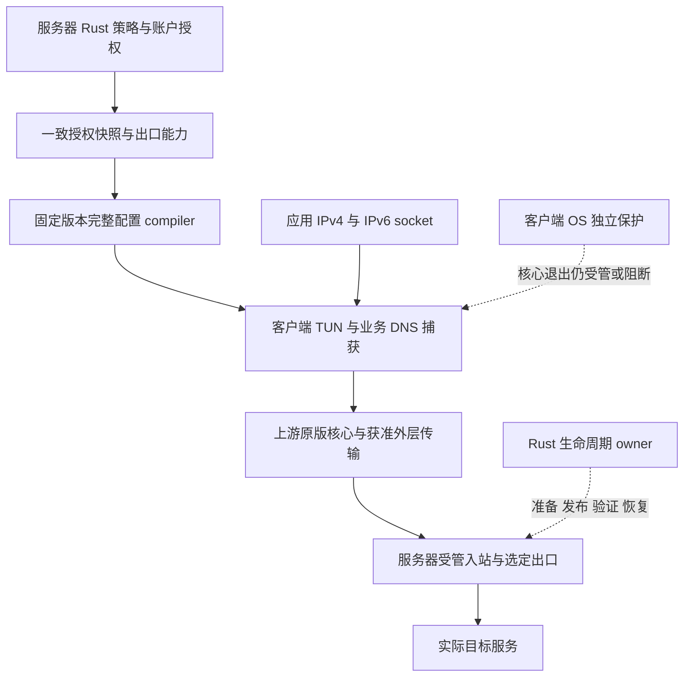

# 服务器管理完整代理配置的已接受设计

本文件归档 2026-10-03 已获用户确认的完整受管配置架构及其书面计划，并对齐截至 2026-10-10 的交付边界。用户选择“按方案进入实施计划”，同时确定只使用上游原版网络内核，控制与管理代码继续由 Rust BUI 承担。**方向已确认；完整 profile、官方计量迁移、各平台真实捕获与故障保护不能因此记为已交付。**

当前恢复分支以 4.1.9 未发布候选继续工作，见 [CHANGELOG](../../../CHANGELOG.md)及[客户端恢复与独立双栈出口保护计划](../../superpowers/plans/2026-10-08-bui-c-recovery-guard.md)。历史计划中的 4.1.6、4.1.7 是当时源码或计划版本，不能用于本轮发版；旧计划中的版本文件写法也不沿用，现行版本来源与门槛以仓库当前规则为准。本次只保存设计与成果，不新增生产动作或重新执行历史实验。

## 用户需要得到的行为

用户从服务器取得一个完整配置，完成一次导入、选中和操作系统 VPN/TUN 授权后，应用 IPv4、IPv6 及业务 DNS 由服务器策略统一管理。用户不需要在多个客户端逐条添加域名、端口、进程或 DNS 例外。选择住宅出口后，失败要明确拒绝，不能悄悄改用本机或 VPS 身份；选择 VPS 出口时，也只在该获准身份内恢复。

“完整接管”以没有 HTTP/SOCKS 代理环境变量的原始应用 socket 为验收对象。系统 VPN 建链、DHCP、邻居发现等必要控制通信按平台明确列出，不能把普通业务绕过放进系统例外。localhost 不发送到远端，局域网业务默认拒绝；平台不能满足时明确报告限制。

服务器配置不能替用户授予 OS 权限，也不能保证第三方 VPN 被关闭后物理路由仍阻断。首次授权和有限的平台开关属于真实使用步骤；核心退出后的断开保护需要独立 OS 实现与验收。协议关闭错误仍按端点交付证据调查，完整 profile 不自动修复 HY2 半关闭问题，见[调查历史](investigation-history.md)。

## 四层拓扑与所有权

| 层 | 责任 | 不得混淆的边界 |
|---|---|---|
| 服务器策略与分发 | 账户默认出口、授权快照、能力记录、完整配置编译、语义版本和分发 | 返回完整 JSON 不证明客户端已加载或获得 OS 权限 |
| 客户端捕获 | IPv4/IPv6 公网业务、DNS、默认路径和未知能力拒绝 | 捕获 IPv6 与成功代理 IPv6 目标是两项能力 |
| 原版核心与外层传输 | 使用获准协议连接代理服务器，按真实协议语义转发 | 外层用 IPv4 也可能承载 IPv6 目标；不得据外层地址族推断出口能力 |
| 服务器入站与出口 | 授权收敛、住宅/VPS 身份、族与协议准入、配置和进程生命周期 | 住宅失败不能以 VPS 成功替代；服务 active 不等于业务路径健康 |

账户授权继续复用现有授权真源，不新建客户端权限数据库。选择一个 Rust 策略模型和统一 compiler，是为了避免订阅 renderer、bui-c 与第三方模板各自维护互相偏离的 DNS、路由和失败策略。原版内核处理网络协议，BUI 负责其已证明能表达的控制语义。不会以这份设计为由维护私有关闭补丁、添加旧 minor 兼容层或要求所有用户迁移到新开发的 VPN 客户端。

## 统一策略合同

### 捕获策略 CapturePolicy

受管模式默认捕获 IPv4、IPv6 公网业务，业务 DNS 经选定获准出口。没有国家、业务域名、业务端口或业务进程的本机 DIRECT 规则。当前物理网没有公网 IPv6，也不能永久省略 IPv6 捕获；网络后续出现 IPv6 时必须仍符合合同。

代理外层连接需要独立、有限的 bootstrap 与防递归机制。节点地址解析只服务于节点建链，不能成为业务 DNS 超时后的直连备用；不能将整个核心进程或所有 DNS 流量无条件放行。平台若完全禁用 IPv6 或不能建立所需 TUN，应明确拒绝管理模式，不能显示完整接管后静默运行部分策略。

### 选定身份 SelectedEgress 与出口能力 EgressCapabilities

管理员明确指定账户默认出口身份。新账户创建时完成绑定；已有账户只从明确的历史身份迁移，两类权益共存但没有默认身份时要求一次指定，不能依节点顺序、速度或剩余可用节点猜测。profile 只筛选已经授权的同身份节点，不创造权限或凭据。

能力分为 IPv4 TCP、IPv4 UDP、IPv6 TCP、IPv6 UDP 四项，至少保存状态、出口身份、路径指纹、观察时刻、失效时刻和验证范围。声明能力只是线索；运行准入只接受与当前路径一致、未过期的实际验证。未知、不支持、证据过期、供应商绑定或端点变化，都不能沿用旧许可。

一次 TCP 端口探测不能证明所有 TCP 端口，更不能证明 UDP。VPS 的 IPv6 成功不能给住宅授予 IPv6 能力；HTTP 供应商缺 UDP 能力时仍应拒绝，不得经 VPS UDP 代发。服务器 native 出站、relay DNS、供应商路径和客户端 compiler 必须消费一致语义，不能只删除客户端 IPv6 reject。

短时健康抖动与能力检查不应频繁改变 profile 或触发全量重启。能力失效后的运行时拒绝与恢复由服务器准入和生命周期负责。若上游原版接口无法表达所需族/协议围栏，必须拒绝开放相应能力或限制独立服务准入；不能虚构每流鉴权，也不能以高频重启代替设计。

### 客户端能力 ClientCapabilities

适配器由明确 target 选择；User-Agent 只作提示，不授予权限，也不能证明 OS、核心版本、VPN 权限或 IPv6 开关。能力记录应区分完整配置消费、双族捕获控制、首次授权、更新方式、更新是否重启核心和退出后的 OS 保护。

初始固定目标为 v2rayN/macOS 与 sing-box 1.14.2，bui-c Linux 复用同一业务策略。Android 与 iOS 分别交付，未设备验收保持“未验收”，不能自动生成看似完整但语义不足的配置。固定版本能力核查仅支持当时版本，不代表以后每个版本都具有相同加载行为。

### 失败策略 FailurePolicy

业务失败默认拒绝；住宅失败不回落 VPS 或本机，不按延迟跨身份选择。回滚只恢复仍获准的旧配置，已撤权策略不得作为恢复可用性的退路。配置服务器离线、无效 JSON、截断响应或 503 不能让服务器返回临时 DIRECT 配置。

撤权不能只靠订阅刷新。native HY2 的鉴权发生在 QUIC 登录，已有会话中新 stream、UDP association 和 TCP 的撤权语义必须分别验证；不能把连接级鉴权描述为每个请求均重新授权。旧缓存、订阅错误与业务连接是否还存在分别观察，HTTP 403/503 本身不证明旧流已终止。

## 服务器分发与发布合同

现有接口保留各自载荷含义，不把“节点已更新”显示成“系统已接管”。

| 接口形态 | 内容与边界 |
|---|---|
| `/api/sub/<token>` | 节点 URI 列表；不包含完整 TUN、DNS、路由或 OS 权限策略 |
| `/api/subscription/<token>` | 完整 sing-box 配置；实际捕获、转发能力仍需目标客户端验收 |
| `/api/clash/<token>` | 对应客户端配置；TUN 开关与加载边界按实际消费端验证 |
| `/api/nodes/<token>` | BUI 客户端结构化导入；不能默认视作所有第三方平台的完整配置 |
| 拟定 `/api/profile/<token>/<target>` | 明确 target 的完整受管配置；页面默认展示完整配置入口，并把 URI 标为“仅节点” |

发布元数据包括稳定名称、策略 schema、语义 revision、target、固定核心要求、选定出口、内容摘要和首次必要动作。应用版本与策略 revision 分开；只有实际语义变更才发布新 revision，同一授权快照与 target 生成相同字节，不混入当前时间、随机备注或探测延迟。

响应体必须是客户端原生可解析的配置对象。元数据放在页面、响应头或受控 manifest，不额外包装 sing-box JSON。未知 target、缺默认身份、无权限和同身份不可用返回明确错误，不降级为节点列表后声称全接管。历史计划建议的状态分别为 400、409、403、503；这些是接口候选合同，不能当成当前端点已经实现。

所有节点、账户权限和能力来自同一次一致快照。现有 publication permit 保护取快照阶段，锁释放后的 renderer 或 HTTP 发送不自动受到同一 fence 保护。如果交付需要发送前复核 revision，应明确定义短期复核与失败行为，不能长时间持有账户写锁等待慢客户端，也不能把 mutex 描述为已经存在的网络响应屏障。

配置和 token 只经 HTTPS 交付，账户/target 缓存隔离，不写完整 URL 或配置正文到公开日志。计划采用私有、禁止存储的缓存策略并以内容摘要生成 ETag，但 ETag 不证明第三方客户端不会 Reload。账号轮换与撤销仍由既有授权体系处理，参数不得增权。

## 更新、回滚与客户端流程

v2rayN/macOS 的预期流程是：复制完整配置入口、导入更新、选中稳定名称、首次开启 TUN 并授权、设置适当的更新周期。服务器负责后续 DNS、路由和出口策略。真实验收要确认完整配置确实被复制并运行、选中项在刷新后保持、无代理环境的 socket 进入 TUN，不能只看订阅条目出现。

当时固定版本源码核查显示 v2rayN 成功更新可触发 Reload，因此不以秒级或分钟级轮询模拟实时控制。相同内容刷新与实际变更刷新都需要观测 PID、活动配置、配置摘要和旧流字节；没有实证就不能宣传无中断。服务端撤权时效不依赖客户端较慢的刷新周期。

BUI 自管客户端比较内容摘要后再校验、发布、激活和回滚，无变化不扰动运行实例。回滚对象必须仍获准；否则进入拒绝态。启动、停止、内核替换、更新、自动恢复和卸载等真实动作应服从同一生命周期所有权，避免旧观测和独立写者在中途覆盖新配置。

配置取得本身需要有限控制通道。首次无代理时应可获取本账户配置，运行中优先经过获准路径；第三方应用可能自行直连下载配置，其行为要单独披露与验证。控制通道的许可不得扩展到任意业务流量。

## 各平台能力与交付边界

| 目标 | 历史核查得到的能力 | 发布前仍必须实际验证 |
|---|---|---|
| v2rayN 7.25.4 / macOS | 支持完整 sing-box Custom 配置；首次 TUN 提权与更新设置在本地，更新可能 Reload | 完整配置加载、双族 TUN、冷 DNS、原始 socket、网络变化、更新影响和退出后的 OS 行为 |
| bui-c / Linux | 可复用统一 Rust 策略与 renderer，并由自管生命周期执行发布和恢复 | 独立双栈 guard、当前实例资格、全部调用者、systemd hooks、冷启动与物理故障；以 10-08 计划的最新状态为准 |
| v2rayNG 2.2.6 / Android | 完整配置属于 Xray；VPN 层 IPv6、DNS、LAN/分应用绕过及定时更新包含本地设置 | 独立 Xray 适配、首次 VPN/IPv6 设置、绕过开关和实际设备接管；不能直接交付 sing-box JSON |
| Shadowrocket / iOS | 已有远程规则、IPv6 和加密 DNS 的能力调查 | 当前字段、导入路径、更新行为与设备实际流量尚需验收；不能采用未经核实的配置样例声称完整支持 |

Linux OS 保护不必被伪装成 Mac profile 已具备的功能，反之也一样。后续 Linux 恢复任务已经成为独立交付单元：规则基础拒绝不随核心退出而消失，核心例外绑定实际身份与获准端点，Unknown 资格不授予启动/恢复。这项演进详见[当前恢复计划](../../superpowers/plans/2026-10-08-bui-c-recovery-guard.md)，不能用早期 Mac 方案的较小范围撤销当前 Linux 门槛。

## 原版发行物与计量迁移前置 G0

上游源码自行构建并增加计量标签，与上游官方归档原件是两个不同的发布身份。历史审计发现原住宅计量依赖额外 `with_v2ray_api` 能力；仅换成官方原件或删掉旧字段，不能同时保证初始化、计量和配额撤权。旧测试的“stock”命名不改变其实际二进制来源。

固定 sing-box 1.14.2 的新控制 API 提供显式用户、连接身份、累计字节和连接事件，是候选迁移路径。有限关闭历史与可能丢失的事件意味着它不是天然的持久、无损逐用户账本。G0 的目的在于先确认这一原版接口能够支持哪些计量与故障拒绝保证；原审计和书面计划没有把它记为通过。

G0 必须使用核实官方 archive 与裸 binary 摘要的实际原件，执行两组以上合成身份的 IPv4/IPv6 TCP/UDP 业务、短连接与持续双向流，并独立核对目标收到的字节与归户账本。重复事件、reset、重连、关闭尾部、队列压力、超过关闭历史容量、消费者退出和核心重启分别覆盖。关键结果只有三种：完整恢复、明确发现缺口并实际拒绝、未满足要求；缺失身份或零计量不能自动通过。

计量缺口时还要验证实际门位拒绝及存量流的处置，不能只返回一个错误或在 UI 标红。累计去重按实例代际、连接 UUID 和用户身份绑定；初始快照中的已关闭连接不算在线；总量与归户统计不是原子快照，不能把差额随意均摊给用户。配置 check、RPC 成功和读计数都不能替代端点交付。

G0 未通过时可以保留纯 Rust 策略、compiler、API 和页面候选，但不能据此生产切换计量或官方分发来源，不能承诺任意负载和任意断线下精确计费。需要迁移时另立实际账本、发布锁、安装、升级与回滚任务；不得回到维护定制核，也不得隐瞒计费缺口。该前置的历史依据已归档于[调查历史](investigation-history.md#原版内核决策如何替代早期试验)。

## 书面实施计划的任务分解

| 阶段 | 应交付的具体产物 | 必须拒绝的错误成功条件 |
|---|---|---|
| G0：官方控制 API | 固定官方原件、可复验隔离 fixture、归户与拒绝证据、能力限制 | 只看版本号、跳过真实测试、把事件缺失当零、把 RPC 成功当业务交付 |
| 1：纯策略模型 | 选定身份、客户端 target、四项出口能力、路径/有效期判据、已有节点过滤 | Unknown 自动放行、路径变化继承旧证据、按测速跨身份选节点 |
| 2：账户和一致快照 | 管理员默认绑定、语义 revision、单次授权与能力投影、明确交付错误 | URL 参数增权、住宅失效改选 VPS、多个读取拼成不一致快照 |
| 3：完整 compiler | 固定 1.14.2 双族捕获、同身份业务 DNS、窄 bootstrap、私网及未知能力拒绝 | 业务 direct、DNS 失败直连、只验 JSON 结构、不执行目标分支 |
| 4：接口与页面 | 明确 target 的原生配置响应、稳定名称、确定性字节、账户缓存隔离、首次动作说明 | 节点列表冒充完整配置、未验收平台显示可用、频繁刷新暗含无损承诺 |
| 5：真实 Mac 闭环 | 实际导入/授权/加载、双族与冷 DNS、失败/旧缓存、网络切换、更新和退出记录 | 显式代理请求冒充 TUN、无 IPv6 上行仍记防泄漏通过、profile 成功记成 HY2 已修复 |
| 后续闭环 | VPS 与住宅真实双栈能力、Android/iOS 各自交付、Linux 独立生命周期与保护 | 一个平台或一种身份的通过替代其余平台/身份 |

原书面计划列过候选 Rust 接口：`EgressIdentity`、`ClientTarget`、`EvidenceStatus`、`Evidence`、`EgressCapabilities`、`ManagedPolicy`、`ManagedDelivery`、`ManagedRuntime` 与 `compile`。它们表达的是职责边界，不能仅因名称出现在计划里就声称这些模块已接入产品。证据必须绑定路径与有效期；Verified 只能由内部真实验证生成，不能接收外部任意 JSON 自我授予资格。

每个任务要求先有明确到达的失败用例，再完成对应实现与独立审查。真实内核缺失、测试过滤为空或分支未到达都不能静默通过。纯策略测试、实际核心业务、真实 OS 接管和发布门槛分别记账；先前某个快照的全绿不自动覆盖后来新增源码。

## 完成标准与未完成状态

| 验收层 | 应保存的实际证据 | 当前文档可作出的结论 |
|---|---|---|
| 授权和身份 | 同一快照、同身份节点、到期/撤销/未知拒绝、重复输入字节一致 | 已形成设计及任务合同，不据此宣称所有目标已实现 |
| 原版核心 | 官方来源、裸 binary 摘要、生成配置真实 check/run、所有目标分支实际执行 | HY2 A/B 已有特定关闭失败记录；G0 的通过不能由该实验替代 |
| 双族与 DNS | 原始 socket、IPv4/IPv6 literal、A/AAAA-only、TCP/UDP、冷缓存 DNS 与应用 DoH、目标实际身份 | 不以显式代理命令或检测站不可达判接管/防泄漏通过 |
| IPv6 防旁路 | 客户端有真实可达的原生 IPv6 对照，启动、运行、后出现 IPv6、网络变化和退出都覆盖 | 当时无公网 IPv6 的现场不足以完成此项 |
| 出口双栈 | VPS 与住宅各自目标族/协议、DNS、MTU 与故障行为 | 捕获后拒绝可单独验收；真正双栈可用须另有实际出口闭环 |
| 失效与撤权 | 同身份故障、旧缓存、订阅错误、DNS 失败、授权改变、核心退出与实际阻断 | 没有 OS 保证的平台明确限制；不把服务器拒绝等同客户端断网 |
| 更新连续性 | 重复刷新与语义变更、PID/实例、活动配置、135 秒双向序列和完整字节 | 未实证前只承认可能重建，不宣称无损 |
| Linux 完整生命周期 | guard、renderer、owner、全部调用者、真实 hooks、冷启动和物理故障联合通过 | 4.1.9 仍为未发布候选，按当前恢复计划继续，不以局部成果宣布防泄漏完成 |

所有验收记录应分别使用通过、失败、未验收或不支持。官方 HY2 A/B 中 36 项半关闭业务失败继续保留，完整配置交付即使通过也不能覆盖该事实；任何传输替代先用相同交付判据验证，并保持出口身份和授权。

## 归档来源

本文件保存的是原批准设计和实施计划的公开实质内容：用户目标、四层职责、策略与接口、原版计量前置、平台差异、任务阶段和验收要求。私有地址、账号、凭据、原始配置、日志及本地绝对路径不随文档公开。源文件中的阶段版本、旧版本文件约定和当时执行等待状态以本文开头的当前边界为准，不重新作为本轮操作指令。

| 来源文件 | 身份与用途 |
|---|---|
| `2026-10-03-managed-full-capture-design.md` | 文件明确标记用户 10-03 已批准；SHA-256 `d2f010d9f7164cd8020fd2a2cfb00235d4f1eec97479e05d455cc1897afbdc1f`；本文主要设计来源 |
| `2026-10-03-managed-full-profiles.md` | 书面 G0 与五项任务、真实平台验收及发布围栏；SHA-256 `892cceb9ccb67eb8dfdb248e1282b5dc482aede8f75ecd45140c91600dee41f0` |
| `handover-20261003-1732.zh.md` | 记录已批准设计、进入书面计划及当时未实施边界；对应来源身份见[调查历史](investigation-history.md#公开来源与历史档案身份) |
| [住宅生命周期 owner 设计](../../superpowers/specs/2026-10-01-residential-lifecycle-owner-design.md) | 复用的服务端配置、共享核心、授权读回与恢复所有权 |
| [客户端恢复与独立双栈出口保护计划](../../superpowers/plans/2026-10-08-bui-c-recovery-guard.md) | 本轮 Linux 4.1.9 候选当前范围、阶段证据与尚未满足的门槛 |
| [CHANGELOG](../../../CHANGELOG.md) | 4.1.x 候选与未发布状态；不可用设计批准或私有构建代替正式发版 |
